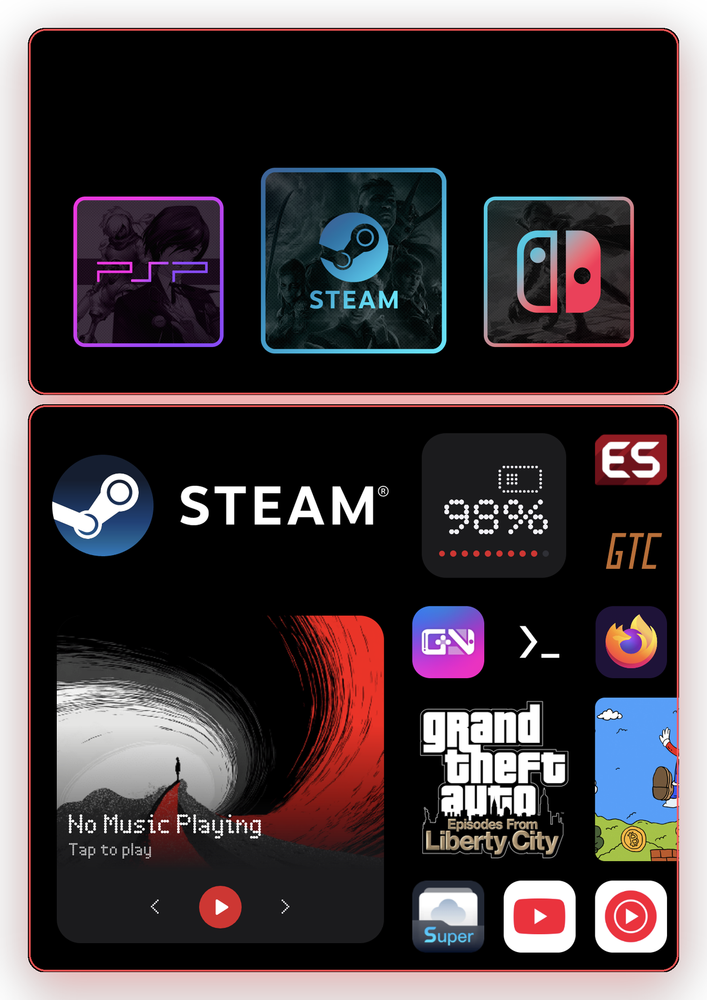

<h1 align="center">Járngreipr 🧤</h1>

<p align="center">
  <a href="https://ko-fi.com/jarngreipr"></a>
  <br/><br/>
  <a href="https://github.com/BrianJr03/Jarngreipr/releases"></a>
  &nbsp;&nbsp;
  <a href="https://github.com/BrianJr03/Jarngreipr/releases/latest"></a>
  &nbsp;&nbsp;
  <a href="https://github.com/BrianJr03/Jarngreipr/releases/latest"></a>
  &nbsp;&nbsp;
  
</p>

**Designed with dual-screen devices in mind, Jarngreipr is a clean, powerful launcher that lets you decide exactly where your apps open, browse your game library, and drive an ES-DE setup from the second screen.**

Pairs with [Mjolnir](https://github.com/blacksheepmvp/mjolnir) on the AYN Thor to turn the Home button into a dual-screen controller. Works on any Android 13+ device; dual-screen features light up on devices with a second display.

Just as **Thor** needs his iron gloves, **Járngreipr** 🧤, to safely wield **Mjolnir** 🔨, this launcher helps you grip control of your device's interface.

---

<p align="center">
  
</p>

---

## 🚀 What is Jarngreipr

Three things in one app, each usable alone.

- **A launcher.** A free-form `Canvas` page, folders, widgets, themes, RSS feeds, and full gamepad navigation.
- **A game frontend.** Scans your ROM folders, scrapes artwork, launches the right emulator per system. Systems and games browse on the top screen; art mirrors to the bottom.
- **An ES-DE companion.** Turns the second screen into a live wallpaper, marquee, music surface, and effects stage that reacts to whatever ES-DE is showing on top.

---

## ✨ Highlights

- **Canvas** — one continuous grid that holds apps, folders, ROMs, widgets, live game art, GIFs, and RSS tiles together.
- **Frontend game library** — 40-system catalog, 204 built-in system logos, ~110 known emulators wired up with the right launch intent.
- **Scraping** — ScreenScraper and SteamGridDB with per-game, per-system, and `Scrape all now` background jobs.
- **Dual-screen swap** — click L3 or R3 anywhere to swap the top and bottom screens, with an animated hand-off.
- **Per-app launch display** — pick `Primary`, `External`, or `Ask` for every app.
- **ES-DE mode** — wallpaper, marquee logo, music, jingles, konfetti, and screensaver all react within half a second of an ES-DE event.
- **Theme sharing** — broadcast your current theme over BLE to nearby Jarngreipr devices; receive wallpapers over Nearby Connections.
- **Backup & Restore** — export your entire setup to JSON and bring it back on a new device.

---

## 🧩 Canvas

The flagship page type. `One continuous grid that holds apps, folders, ROMs, and widgets together.` Canvas is the default page on a fresh install.

**What you can add** (from the `Add` menu): `App`, `Folder`, `ROM`, `Widget`, `Frontend Tile`, `Photo container`, `RSS launcher`, `RSS widget`.

**What makes it different from the older tabs:**

|                                   | Apps Tab | Apps & Widgets Tab | Canvas |
|-----------------------------------|:--------:|:------------------:|:------:|
| Apps                              |    ✅    |         ✅         |   ✅   |
| Widgets                           |    ❌    |         ✅         |   ✅   |
| Folders                           |    ✅    |         ✅         |   ✅   |
| Pinned ROMs                       |    ✅    |         ❌         |   ✅   |
| Frontend Tile     |    ❌    |         ❌         |   ✅   |
| Last Played Tile   |    ❌    |         ❌         |   ✅   |
| Photo containers, GIFs            |    ❌    |         ❌         |   ✅   |
| RSS launcher and now-playing tile |    ❌    |         ❌         |   ✅   |
| Separate portrait and landscape   |    ❌    |         ❌         |   ✅   |
| Push-based move, resize, `Tidy now` |    ❌    |         ❌         |   ✅   |

**More:** `Edit mode`, `Scroll orientation` (`Vertical` / `Horizontal`), 1 to 12 columns and rows, long-press empty space for the `Canvas Menu`, in-app `Welcome to Canvas` onboarding.

---

## 🎮 Frontend (game library)

Enable: `Settings` → `Extras` → `Enable frontend`. `Browse your library from a system → games screen on the top display, with art mirrored to the bottom.`

**Library.** Point it at ROM folders (SAF). Scans run in the background and re-run when an SD card is mounted. 40 systems ship in the catalog (NES through Switch, DOS through Winlator); the catalog is JSON under `frontend/src/main/assets/systems/`, open to PRs.

**Browsing.** Systems view in `Row` or `Grid`, chosen separately for the top and bottom screen. Games view with per-system layouts. Search commands: `@android`, `@hidden`, `@{platform}`; plain text matches name, system, genre, developer, publisher. Hide systems or games. Reorder systems. Per-system customization: tile background, color, default emulator, ROM folder.

**Game details.** `Launch`, `Favorite`, `Hide`, `Pick Emulator`, `Change Core`, `Scrape`, `Edit Info`, `Companion`, media type per game. Stats include genre, developer, publisher, players, rating, play count, play time.

**Emulators.** About 110 known emulators wired with the right launch intent per system: RetroArch cores, PPSSPP, AetherSX2 and NetherSX2, Dolphin, Azahar, Eden, Yuzu, aX360e, Winlator variants, and more. Resolution order: per-game → per-system → extension fallback → picker.

**Scraping.** ScreenScraper (user account) and SteamGridDB (API key).
- Per-game `Scrape` and per-system `Scrape Media` download artwork.
- `Scrape all now` runs as a background job with a notification.
- Output lands in `/storage/emulated/0/Jarngreipr Media/<system>/<kind>/`.

**ES-DE compatibility.** `Read gamelist.xml` pulls titles, descriptions, and ratings from an existing ES-DE setup. ES-DE's `downloaded_media` and RetroHrai! art folders are read automatically. You do not need ES-DE installed.

---

## 🖥️ Dual-screen

- **Swap screens.** `Settings` → `ES-DE` → `Dual-screen` → `Swap screens`, or click L3 or R3 anywhere. Animated hand-off. The choice is remembered.
- **Home button gestures** (Thor, via accessibility service). `Press once` opens the launcher on the bottom; `Double press` opens the frontend; `Long press` opens both. Disable Mjolnir's accessibility service first, since both apps bind the Home button.
- **Per-app launch display.** `Launch on Primary Display`, `Launch on External Display`, or `Ask`.
- **Companion apps.** Bind an app to a game; it launches on the opposite screen alongside the game (guides, Discord, a second emulator window).
- **Frontend Tile.** A Canvas tile that shows art for whatever is focused in the frontend: covers, marquee, fanart, screenshots, miximages, or description. Tap for game details.
- **Audio.** `Top Screen Volume` and `Bottom Screen Volume` controlled independently.
- **Game launch helpers.** `Wake Method`, `Persist Display on Game Launch`, `Control Power on Game Events`.

---

## 🎭 ES-DE companion mode

Turn the frontend off and Jarngreipr becomes a live companion for ES-DE running on the other screen.

**Setup.** `Settings` → `ES-DE` → `Run Setup Wizard`. Installs event scripts into `/storage/emulated/0/ES-DE/scripts`; ES-DE writes events, Jarngreipr reacts within half a second.

**What reacts to ES-DE focus:**

- **Wallpaper.** `Appearance` → `Wallpaper` → `ES-DE`, with blur, dim, and image-type choices.
- **Marquee logo.** Size, alignment, `Logo Only Mode`, double-tap shortcut.
- **Background music.** System, game, and screensaver tracks. `System-Specific Music` picks a different track per system folder.
- **Jingles.** Collections pulled from GitHub repos, with regex priority rules.
- **Konfetti.** Custom animations on select and launch.
- **Screensaver.** `ShowContent` or `PowerOff` behaviors.
- **Power.** Screen off on launch, on at exit.
- **Video playback.** Uses the Presentation API to route video to the external display.

**System Apps.** Link each ES-DE system folder to an Android app for one-tap launching.

**Broadcasts** for scripts and automation: `jr.brian.SET_ESDE_WALLPAPER`, `jr.brian.SET_STANDARD_WALLPAPER`.

**Extras.** `Hide UI When Browsing Games`, `Delete Empty Folders`, `Custom Paths`.

---

## 🏠 Launcher features

**Pages.** Canvas (default), Apps Tab, Apps & Widgets Tab, App Drawer Tab, RSS Tab. Unlimited pages, per-page type.

**Apps.** Folders, free positioning with `Snap Mode`, visibility per page, custom icons (PNG or GIF), icon packs (Lawnicons, Arcticons, any), name and size options, `Recent Apps`, `Quick Delete`, `Back Button Shortcut` (11 actions).

**Widgets & Dock.** On Apps & Widgets pages: resizable Android widgets from any installed app, a pinned dock row.

**Gamepad.** Full D-pad navigation, built-in on-screen keyboard, `GamePad` control of the main display via Shizuku, `Control Pad` button and joystick mappings.

**Appearance.** 7 built-in themes plus `Create Custom`, `OLED Black Mode`, `Icon Shape`, wallpaper as image, GIF, video, system, or ES-DE.

**RSS.** Add feeds (RSS 2.0 and Atom), audio and video playback, `Now Playing` shade with system equalizer support.

**Audio.** Launcher `Background Audio` keeps music playing underneath.

**Sharing.** `Theme Sharing` over Bluetooth (Ping) with a Quick Settings tile. Wallpaper sharing over Nearby Connections.

**System.** `Backup` and `Restore` to JSON, `System Monitor`, `Crash Logs`, `Check for Updates`, in-app `FAQ`, `What's New`, `Floaty Mode` easter egg (tap the version 7 times).

### What is Ping?

[Ping](https://github.com/BrianJr03/Ping) is an open-source library that powers `Theme Sharing` between two Jarngreipr devices. It uses Bluetooth Low Energy for themes and Google's Nearby Connections API for wallpapers. Open `Settings` → `Appearance` → `Theme Sharing` to get started.

---

## 📋 Requirements

- **Android 13 (API 33)** or higher.
- **Dual-screen features** need a second display. Swap and Home gestures are Thor-only.
- **Optional:** Shizuku (for `GamePad`), ES-DE (companion mode), RetroHrai! media packs.

---

## 🛠️ Install

### From Releases

1. Download the latest APK from the [Releases](../../releases) page.
2. Enable installs from unknown sources if prompted.
3. Install, then set Jarngreipr as your default launcher.

### From Source

```bash
git clone https://github.com/BrianJr03/Jarngreipr.git
cd Jarngreipr
./gradlew assembleStandardDebug
adb install app/build/outputs/apk/standard/debug/*.apk
```

- JDK 17 required. Android Studio Ladybug or newer.
- Flavors: `standard` and `hidden`. The `hidden` flavor removes the app from Recents and adds an `h` suffix to the package name.
- Release builds are unsigned unless you pass `-Pandroid.injected.signing.*`.
- ScreenScraper dev credentials are optional for local builds. Pass `-Pscreenscraper.devId` and `-Pscreenscraper.devPassword`, or set them as environment variables.

---

## 🎯 Getting started

Three paths, pick the one that fits.

**Just a launcher.** Install → set as default → the first page is already a Canvas → long-press empty space to add apps, folders, widgets, and ROMs.

**Game frontend.** `Settings` → `Extras` → `Enable frontend` → `Settings` → `ES-DE` → `Systems` → `Add Systems` → pick ROM folder(s). On the top screen, press START for `Frontend Settings`, enter your ScreenScraper account, then `Scrape all now`.

**ES-DE companion.** Install ES-DE → `Settings` → `ES-DE` → `Run Setup Wizard` → enable scripts in ES-DE → set wallpaper to `ES-DE`.

---

## 📡 Theme Sharing (Ping)

Jarngreipr supports sharing themes and wallpapers wirelessly with nearby devices using [Ping](https://github.com/BrianJr03/Ping) (Bluetooth LE) and the Nearby Connections API.

**Theme sharing (BLE).** `Settings` → `Theme Share` → grant Bluetooth and battery-exempt permissions → tap `Start Sharing`. Enable auto-start to broadcast every time the launcher opens. A system Quick Settings tile toggles broadcasting without opening the app.

**Wallpaper sharing (Nearby).** Same screen, toggle `Nearby Wallpaper` to discover senders. Received wallpapers appear in `Received Wallpapers`.

| Permission | Purpose |
|------------|---------|
| `BLUETOOTH_SCAN` / `BLUETOOTH_ADVERTISE` / `BLUETOOTH_CONNECT` | BLE theme broadcasting |
| `FOREGROUND_SERVICE` / `FOREGROUND_SERVICE_CONNECTED_DEVICE` | Background sharing |
| `ACCESS_FINE_LOCATION` / `ACCESS_WIFI_STATE` / `CHANGE_WIFI_STATE` | Nearby wallpaper discovery |
| `NEARBY_WIFI_DEVICES` (API 33+) | Nearby Connections |

---

## 🤝 Contributing

Fork, branch off `main`, open a PR against `dev`. The project uses Jetpack Compose, Hilt, Room, WorkManager, media3, Coil, and OkHttp; new features should ship with tests.

System JSON lives under `frontend/src/main/assets/systems/` and is a good first contribution target.

---

## 🐛 Bug reports & feature requests

[Open an issue](../../issues). For bugs include device model, Android version, and reproduction steps. For questions, check the in-app `FAQ` first.

---

## 💖 Support

If you enjoy using Jarngreipr, consider supporting development:

- ☕ [Ko-fi](https://ko-fi.com/jarngreipr) — early builds and the main support channel.
- 💬 Discord community (link in-app, under `Settings` → `About`).

---

## 🏗️ Tech stack

- **Modules:** `:app`, `:core-model`, `:core-ui`, `:frontend`.
- **Language:** Kotlin 2.3, Jetpack Compose BOM 2026.02, Material 3.
- **Build:** AGP 9.0, JDK 17, Gradle Kotlin DSL.
- **Architecture:** MVVM with Hilt DI, Kotlin Coroutines and Flow.
- **Persistence:** SharedPreferences, DataStore, and two Room databases (launcher + library).
- **Async work:** WorkManager (scraping, library scans).
- **Media:** media3 for audio and video, Coil for images.
- **Networking:** OkHttp.
- **SDK:** `minSdk 33`, `targetSdk` / `compileSdk 37`.
- **Testing:** JUnit, Turbine, MockK across unit and instrumented suites.

CI runs unit tests and lint on every push; a dedicated `build-apks.yml` workflow produces sideload-friendly debug and release APKs on demand.

---

## 📝 License

MIT. See [LICENSE](LICENSE).

---

## 🙏 Acknowledgments

- **AYN** — for the Thor handheld that shaped the dual-screen design.
- **Mjolnir** — the companion app for Home-button dual-screen control.
- **ScreenScraper** and **SteamGridDB** communities — for the art and metadata that make scraping possible.
- **Icon pack creators** — for keeping things beautiful.
- **Community contributors** — for feedback, bug reports, and feature ideas.
- **You** — for using Jarngreipr! 🧤
- Icons from [Icons8](https://icons8.com): Ko-fi, Discord, Buy Me a Coffee.

---

**Made with ❤️ by [BrianJr03](https://github.com/BrianJr03)**

*Wield your launcher like Thor wields Mjolnir* 🔨
