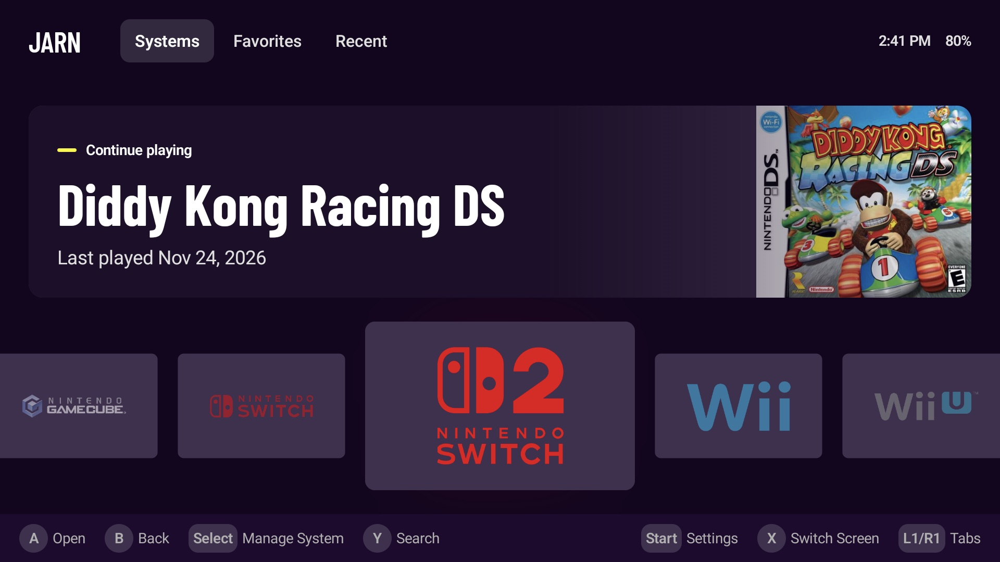
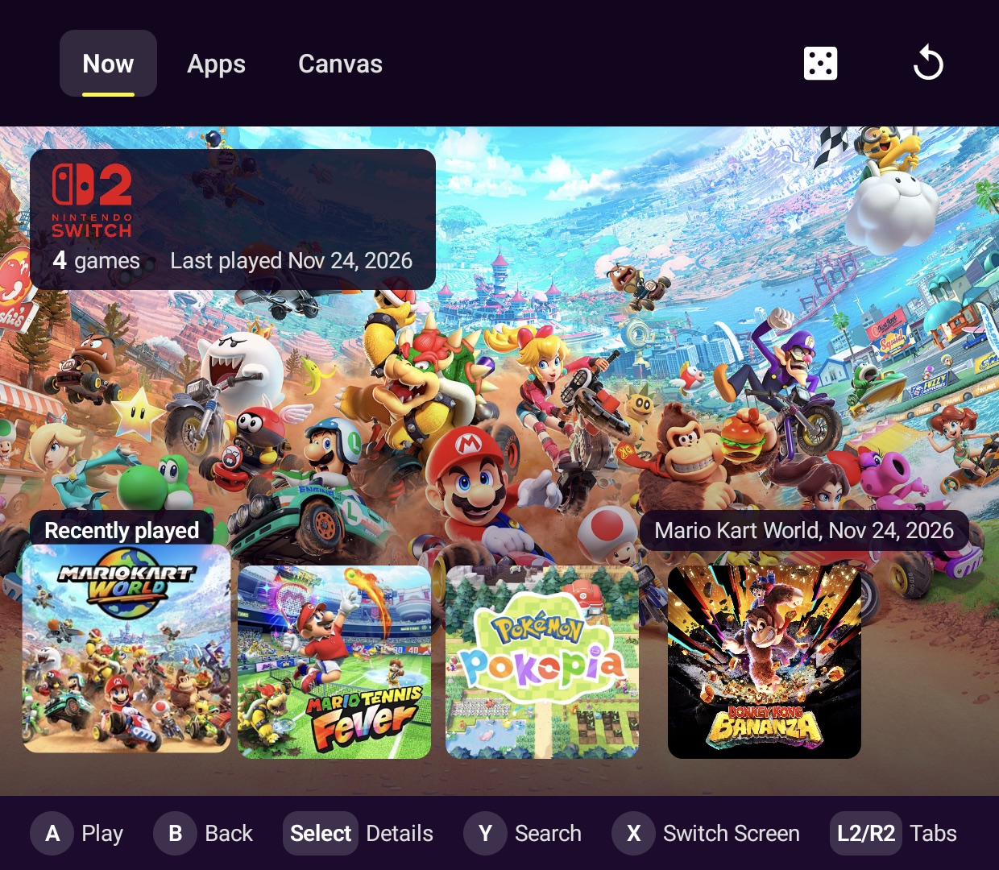

<h1 align="center">Járngreipr 🧤</h1>

<p align="center">
  <a href="https://ko-fi.com/jarngreipr"></a>
  <br/><br/>
  <a href="https://github.com/BrianJr03/Jarngreipr/releases"></a>
  &nbsp;&nbsp;
  <a href="https://github.com/BrianJr03/Jarngreipr/releases/latest"></a>
  &nbsp;&nbsp;
  <a href="https://github.com/BrianJr03/Jarngreipr/releases/latest"></a>
  &nbsp;&nbsp;
  
</p>

**Designed with dual-screen devices in mind, Jarngreipr is a controller-first home for your games and apps. Your library lives on the top screen, and everything you can do with it lives on the bottom.**

Pairs with [Mjolnir](https://github.com/blacksheepmvp/mjolnir) on the AYN Thor to turn the Home button into a dual-screen controller. Works on any Android 13+ device, with or without a second screen.

Just as **Thor** needs his iron gloves, **Járngreipr** 🧤, to safely wield **Mjolnir** 🔨, this launcher helps you grip control of your device's interface.

---

## 🧤 Meet Jarn

**New in 4.0.0.** Jarn is Jarngreipr's new two-screen frontend and launcher, and it's what a fresh install opens.

- **Stage** (top screen): your games. Systems, Favorites and Recent, with a Continue playing banner.
- **Deck** (bottom screen): what you can do with them. Now, Apps and Canvas.

<p align="center">
  
  <br/>
  
</p>

Already using Jarngreipr? Classic shows a short **Meet Jarn** preview after you update. Press **Try Jarn** and your games, favorites, canvas pages and widgets come with you. Nothing changes in Classic or ES-DE, and you can switch back anytime.

---

## 🎮 Controls

| Button | What it does |
|---|---|
| A | Open or confirm |
| B | Go back |
| X | Switch screens |
| Hold X (or click L3 / R3) | Swap the two screens |
| Select | Options for whatever is highlighted |
| Y | Search |
| Start | Settings (Canvas options while on Canvas) |
| L1 / R1 | Change top screen tabs, wherever your controller is |
| L2 / R2 | Change bottom screen tabs, wherever your controller is |

Button hints along the bottom of each screen always show what each button does there. Replay the button tour anytime from `Settings` → `General`.

---

## ✨ Jarn features

**Library.** Browse Systems, Favorites and Recent. Pick `Grid` or `Carousel` for systems and games, with a Shelf carousel and smooth transitions between systems and games. Hide system names and game counts if you want the space for art.

**Now.** The bottom screen shows big art, stats and recently played games for whatever you highlight. A Resume poster gets you back into your last game. Optional `Random` and `Last Played` buttons, system logo, game count and last played date. Systems with little art get a cover wall.

**Games.** Choose the emulator, RetroArch core and art per game or per system. Add up to two companion apps that open beside a game. Play count and play time are tracked.

**Canvas.** One grid for apps, folders, ROMs, widgets, photos, frontend art, last played and RSS tiles. Move, resize and remove tiles with the controller or touch, with undo for every change. Up to 6 pages, with a choice of page transitions. A hands-on tour teaches it the first time.

**Apps and search.** An Apps drawer with pinned, all and hidden apps. A dock, app folders, icon packs and app name options. Search finds games, systems and apps, with a built-in controller keyboard.

**Looks and wallpapers.** Four looks with a live preview, or `Match Command Panel colors` to fit your device theme. Live wallpapers (Starstave, Ironweave, Hearthrise), or an image or GIF per screen. Live wallpapers pause during games, on Battery Saver and with the screen off.

**Sound.** Background music from a folder or a single track. Game jingles from GitHub or local packs, or create your own.

**Scraping.** Guided setup for ScreenScraper (free account) and SteamGridDB (free API key), all from the controller. Scraping only runs when you ask and only adds art that's missing.

**ES-DE ready.** Jarn can find your ES-DE ROMs folder from ES-DE's own settings, and uses ES-DE or RetroHrai! art you already have. You do not need ES-DE installed.

**Home button.** Make Jarn your Home in one step. During a game, Home keeps the game on screen and brings Jarn up on the other screen.

**Backups and updates.** Back up your setup to a file and see exactly what will change before a restore. Check for updates from Settings, and opt into test builds if you like.

**One screen?** Jarn works there too. Your games fill the screen and the Deck opens as a panel.

---

## 🛠️ Install

### From Releases

1. Download the latest APK from the [Releases](../../releases) page.
2. Enable installs from unknown sources if prompted.
3. Install, then set Jarngreipr as your default launcher (Jarn offers to do this for you).

### From Source

```bash
git clone https://github.com/BrianJr03/Jarngreipr.git
cd Jarngreipr
./gradlew assembleStandardDebug
adb install app/build/outputs/apk/standard/debug/*.apk
```

- JDK 17 required. Android Studio Ladybug or newer.
- Flavors: `standard` and `hidden`. The `hidden` flavor keeps the app out of Recents and adds an `h` to the version name (for example `4.0.0h`).
- Debug builds install as a separate app, `Jarngreipr Debug`, so they sit beside a release install.
- Release builds are unsigned unless you pass `-Pandroid.injected.signing.*`.
- ScreenScraper dev credentials are optional for local builds. Pass `-Pscreenscraper.devId` and `-Pscreenscraper.devPassword`, or set them as environment variables.

---

## 🎯 Getting started

**New install.** Open Jarngreipr and Jarn walks you through it: point it at your games folder (or your ES-DE ROMs folder), confirm your art source, pick a look, and learn the buttons. Skip any step and come back to it from `Settings`.

**Coming from Classic.** Press `Try Jarn` on the Meet Jarn preview, or open `Settings` → `System` → `Switch to Jarn`. Your setup is already there. To go back, open Jarn `Settings` → `General` → `Switch to Classic`.

**Box art.** In Jarn `Settings`, open `Scraper setup`, add your ScreenScraper account or SteamGridDB key, test it, and pick which art types to download.

---

## 📋 Requirements

- **Android 13 (API 33)** or higher.
- **Dual-screen features** need a second display. Swap and Home gestures are Thor-only.
- **Optional:** Shizuku (for Classic's `GamePad`), ES-DE (Classic's companion mode, or Jarn's ROMs folder and art), RetroHrai! media packs, Command Panel (to match its colors).

---

## 🕹️ Classic

Classic is the original Jarngreipr experience, and it's still here. Switch between Jarn and Classic anytime; nothing is lost either way.

Classic is also where these live: the legacy page types, the notification shade, Control Pad, Quick Delete, Powered Off, theme sharing, and ES-DE companion mode.

### Canvas

One continuous grid that holds apps, folders, ROMs, and widgets together. Canvas pages are shared, so the pages you build in Classic show up in Jarn and the other way around.

**What you can add** (from the `Add` menu): `App`, `Folder`, `ROM`, `Widget`, `Frontend Tile`, `Last Played`, `Photo container`, `RSS launcher`, `RSS widget`.

|                                   | Apps Tab | Apps & Widgets Tab | Canvas |
|-----------------------------------|:--------:|:------------------:|:------:|
| Apps                              |    ✅    |         ✅         |   ✅   |
| Widgets                           |    ❌    |         ✅         |   ✅   |
| Folders                           |    ✅    |         ✅         |   ✅   |
| Pinned ROMs                       |    ✅    |         ❌         |   ✅   |
| Frontend Tile                     |    ❌    |         ❌         |   ✅   |
| Last Played Tile                  |    ❌    |         ❌         |   ✅   |
| Photo containers, GIFs            |    ❌    |         ❌         |   ✅   |
| RSS launcher and now-playing tile |    ❌    |         ❌         |   ✅   |
| Separate portrait and landscape   |    ❌    |         ❌         |   ✅   |
| Push-based move, resize, `Tidy now` |    ❌    |         ❌         |   ✅   |

**More:** `Edit mode`, `Scroll orientation` (`Vertical` / `Horizontal`), long-press empty space for the `Canvas Menu`, in-app `Welcome to Canvas` onboarding.

### Frontend (game library)

Enable: `Settings` → `Extras` → `Enable Frontend`. Browse your library from a system → games screen on the top display, with art mirrored to the bottom.

**Library.** Point it at ROM folders. Scans run in the background and re-run when an SD card is mounted. 41 systems ship in the catalog (NES through Switch, DOS through Winlator); the catalog is JSON under `frontend/src/main/assets/systems/`, open to PRs.

**Browsing.** Systems view in `Row` or `Grid`, chosen separately for the top and bottom screen. Games view with per-system layouts. Search commands: `@android`, `@hidden`, `@{platform}`; plain text matches name, system, genre, developer, publisher. Hide systems or games. Reorder systems. Per-system customization: tile background, color, default emulator, ROM folder.

**Game details.** `Launch`, `Favorite`, `Hide`, `Pick Emulator`, `Change Core`, `Scrape`, `Edit Info`, `Companion`, media type per game. Stats include genre, developer, publisher, players, rating, play count, play time.

**Emulators.** About 110 known emulators wired with the right launch intent per system: RetroArch cores, PPSSPP, AetherSX2 and NetherSX2, Dolphin, Azahar, Eden, Yuzu, aX360e, Winlator variants, and more. Resolution order: per-game → per-system → extension fallback → picker.

**Scraping.** ScreenScraper (user account) and SteamGridDB (API key).
- Per-game `Scrape` and per-system `Scrape Media` download artwork.
- `Scrape all now` runs as a background job with a notification.
- Output lands in `/storage/emulated/0/Jarngreipr Media/<system>/<kind>/`.

**ES-DE compatibility.** `Read gamelist.xml` pulls titles, descriptions, and ratings from an existing ES-DE setup. ES-DE's `downloaded_media` and RetroHrai! art folders are read automatically.

### Dual-screen

- **Swap screens.** `Settings` → `ES-DE` → `Dual-screen` → `Swap screens`, or click L3 or R3 anywhere. Animated hand-off. The choice is remembered.
- **Home button gestures** (Thor, via accessibility service). `Press once` restores the bottom display, `Double press` restores the top display, `Long press` restores both. Disable Mjolnir's accessibility service first, since both apps bind the Home button.
- **Per-app launch display.** `Launch on Primary Display`, `Launch on External Display`, or `Ask`.
- **Companion apps.** Bind an app to a game; it launches on the opposite screen alongside the game (guides, Discord, a second emulator window).
- **Frontend Tile.** A Canvas tile that shows art for whatever is focused in the frontend: covers, marquee, fanart, screenshots, miximages, or description. Tap for game details.
- **Audio.** `Top Screen Volume` and `Bottom Screen Volume` controlled independently.
- **Game launch helpers.** `Wake Method`, `Persist Display on Game Launch`, `Control Power on Game Events`.

### ES-DE companion mode

Turn the frontend off and Classic becomes a live companion for ES-DE running on the other screen.

**Setup.** `Settings` → `ES-DE` → `Run Setup Wizard`. Installs event scripts into `/storage/emulated/0/ES-DE/scripts`; ES-DE writes events, Jarngreipr reacts within half a second.

**What reacts to ES-DE focus:**

- **Wallpaper.** `Appearance` → `Wallpaper` → `ES-DE`, with blur, dim, and image-type choices.
- **Marquee logo.** Size, alignment, `Logo Only Mode`, double-tap shortcut.
- **Background music.** System, game, and screensaver tracks. `System-Specific Music` picks a different track per system folder.
- **Jingles.** Collections pulled from GitHub repos, with regex priority rules.
- **Konfetti.** Custom animations on select and launch.
- **Screensaver.** `ShowContent` or `PowerOff` behaviors.
- **Power.** Screen off on launch, on at exit.
- **Video playback.** Uses the Presentation API to route video to the external display.

**System Apps.** Link each ES-DE system folder to an Android app for one-tap launching.

**Broadcasts** for scripts and automation: `jr.brian.SET_ESDE_WALLPAPER`, `jr.brian.SET_STANDARD_WALLPAPER`.

**Extras.** `Hide UI When Browsing Games`, `Delete Empty Folders`, `Custom Paths`.

### Launcher features

**Pages.** Canvas (default), Apps Tab, Apps & Widgets Tab, App Drawer Tab, RSS Tab. Up to 6 pages, each with its own type.

**Apps.** Folders, free positioning with `Snap Mode`, visibility per page, custom icons (PNG or GIF), icon packs (Lawnicons, Arcticons, any), name and size options, `Recent Apps`, `Quick Delete`, two `Back Button Shortcut`s with a quick menu to pick between them.

**Widgets & Dock.** On Apps & Widgets pages: resizable Android widgets from any installed app, a pinned dock row.

**Gamepad.** Full D-pad navigation, built-in on-screen keyboard, `GamePad` control of the main display via Shizuku, `Control Pad` button and joystick mappings.

**Appearance.** 7 built-in themes plus `Create Custom`, `OLED Black Mode`, `Icon Shape`, wallpaper as image, GIF, video, system, or ES-DE.

**RSS.** Add feeds (RSS 2.0 and Atom), audio and video playback, `Now Playing` shade with system equalizer support.

**Audio.** Launcher `Background Audio` keeps music playing underneath.

**System.** `Backup` and `Restore` to JSON, `System Monitor`, `Crash Logs`, `Check for Updates`, in-app `FAQ`, `What's New`, `Floaty Mode` easter egg (tap the version 7 times).

### 📡 Theme Sharing (Ping)

Classic can share themes and wallpapers wirelessly with nearby devices using [Ping](https://github.com/BrianJr03/Ping) (Bluetooth LE) and the Nearby Connections API.

**Theme sharing (BLE).** `Settings` → `Appearance` → `Theme Sharing` → grant Bluetooth and battery-exempt permissions → tap `Start Theme Sharing`. Enable auto-start to broadcast every time the launcher opens. A system Quick Settings tile toggles broadcasting without opening the app.

**Wallpaper sharing (Nearby).** Same screen, toggle `Nearby Wallpaper` to discover senders. Received wallpapers appear in `Received Wallpapers`.

| Permission | Purpose |
|------------|---------|
| `BLUETOOTH_SCAN` / `BLUETOOTH_ADVERTISE` / `BLUETOOTH_CONNECT` | BLE theme broadcasting |
| `FOREGROUND_SERVICE` / `FOREGROUND_SERVICE_CONNECTED_DEVICE` | Background sharing |
| `ACCESS_FINE_LOCATION` / `ACCESS_WIFI_STATE` / `CHANGE_WIFI_STATE` | Nearby wallpaper discovery |
| `NEARBY_WIFI_DEVICES` (API 33+) | Nearby Connections |

---

## 🤝 Contributing

Fork, branch off `main`, open a PR against `dev`. The project uses Jetpack Compose, Hilt, Room, WorkManager, media3, Coil, and OkHttp; new features should ship with tests.

System JSON lives under `frontend/src/main/assets/systems/` and is a good first contribution target.

---

## 🐛 Bug reports & feature requests

[Open an issue](../../issues). For bugs include device model, Android version, whether you use Jarn or Classic, and reproduction steps. For questions, check the in-app `FAQ` first.

---

## 💖 Support

If you enjoy using Jarngreipr, consider supporting development:

- ☕ [Ko-fi](https://ko-fi.com/jarngreipr): early builds and the main support channel.
- 💬 Discord community (link in-app, under `Settings` → `About` in Classic, or `Settings` → `General` → `About and support` in Jarn).

---

## 🏗️ Tech stack

- **Modules:** `:app`, `:core-model`, `:core-ui` (including the Jarn design system), `:frontend`, `:jarnfe` (Jarn).
- **Language:** Kotlin 2.3, Jetpack Compose BOM 2026.02, Material 3.
- **Build:** AGP 9.0, JDK 17, Gradle Kotlin DSL.
- **Architecture:** MVVM with Hilt DI, Kotlin Coroutines and Flow.
- **Persistence:** SharedPreferences, DataStore, and two Room databases (launcher + library).
- **Async work:** WorkManager (scraping, library scans).
- **Media:** media3 for audio and video, Coil for images.
- **Networking:** OkHttp.
- **SDK:** `minSdk 33`, `targetSdk` / `compileSdk 37`.
- **Testing:** JUnit, Turbine, MockK across unit and instrumented suites.

CI runs unit tests and lint on every push; a dedicated `build-apks.yml` workflow produces sideload-friendly debug and release APKs on demand.

---

## 📝 License

MIT. See [LICENSE](LICENSE).

---

## 🙏 Acknowledgments

- **AYN**, for the Thor handheld that shaped the dual-screen design.
- **Mjolnir**, the companion app for Home-button dual-screen control.
- **ScreenScraper** and **SteamGridDB** communities, for the art and metadata that make scraping possible.
- **Icon pack creators**, for keeping things beautiful.
- **Community contributors**, for feedback, bug reports, and feature ideas.
- **You**, for using Jarngreipr! 🧤
- Icons from [Icons8](https://icons8.com): Ko-fi, Discord, Buy Me a Coffee.

---

**Made with ❤️ by [BrianJr03](https://github.com/BrianJr03)**

*Wield your launcher like Thor wields Mjolnir* 🔨
